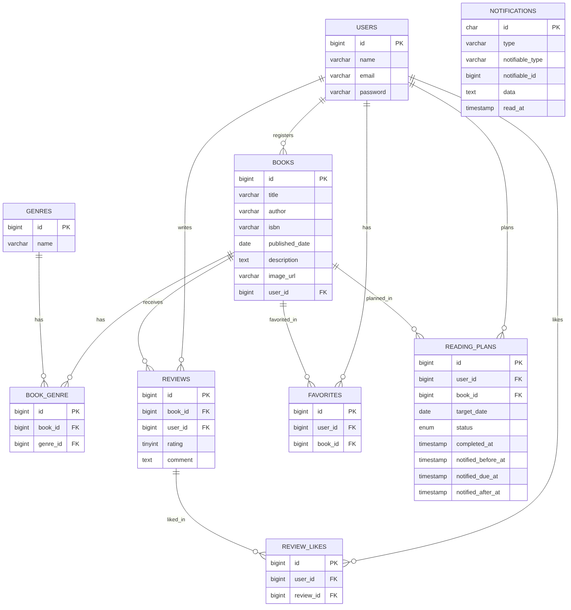

# BookShelf

書籍のレビュー・読書計画を管理するWebアプリケーションです。Laravel 10.xで実装しています。

## 主な機能

### 基本機能

- 会員登録・ログイン（Laravel Fortify）
- 書籍の登録・編集・削除（作成者本人のみ）
- ジャンルの登録・編集・削除
- レビューの投稿・編集・削除（1ユーザー1書籍につき1件まで）
- レビューへの「いいね」
- 書籍のお気に入り登録
- 書籍ランキング（平均評価順）
- 公開API（書籍の一覧・詳細・登録・更新・削除）

### 応用機能

- 書籍のキーワード検索・ジャンル絞り込み・ソート
- ISBN検索による書籍情報の自動入力（Google Books API連携）
- マイ読書レポート（レビュー統計、評価分布、高評価書籍TOP5、ジャンル別評価傾向TOP5）
- 公開APIへのSanctumトークン認証導入（書き込み系エンドポイント）
- 読書計画の作成・編集・完了・削除
- 読書計画のリマインダー通知（事前・当日・失効後）と自動失効バッチ処理

## 技術スタック

| 項目           | 内容                              |
| -------------- | --------------------------------- |
| 言語           | PHP 8.5                           |
| フレームワーク | Laravel 10.x                      |
| データベース   | MySQL 8.4                         |
| 認証           | Laravel Fortify / Laravel Sanctum |
| 開発環境       | Laravel Sail（Docker）            |

## ER図



## 環境構築手順

```bash
# リポジトリをクローン
git clone https://github.com/yuto9990720/bookshelf-app.git
cd bookshelf-app

# 依存パッケージのインストール
composer install

# .envファイルの作成
cp .env.example .env

# Sailの起動
./vendor/bin/sail up -d

# アプリケーションキーの生成
./vendor/bin/sail artisan key:generate

# マイグレーション＋シーディング
./vendor/bin/sail artisan migrate:fresh --seed
```

起動後、`http://localhost` にアクセスしてください。

### ISBN検索機能について

ISBN検索機能（Google Books API連携）を使う場合は、`.env`に以下を設定してください。

```
GOOGLE_BOOKS_API_KEY=your_api_key_here
```

未設定の場合でも動作しますが、APIのクォータ制限にかかりやすくなります。

## 初期ユーザー（シーディングデータ）

| 名前     | メールアドレス        | パスワード |
| -------- | --------------------- | ---------- |
| 山田太郎 | yamada@example.com    | password   |
| 鈴木花子 | suzuki@example.com    | password   |
| 田中一郎 | tanaka@example.com    | password   |
| 佐藤美咲 | sato@example.com      | password   |
| 高橋健太 | takahashi@example.com | password   |

## テスト

```bash
./vendor/bin/sail artisan test
```

カバレッジを確認する場合：

```bash
SAIL_XDEBUG_MODE=coverage ./vendor/bin/sail artisan test --coverage
```

現在のテストカバレッジ: 86.7%

## リマインダーバッチの手動実行

```bash
./vendor/bin/sail artisan reading-plans:send-notifications
```

本番環境ではLaravelのScheduleにより毎日自動実行されます。
